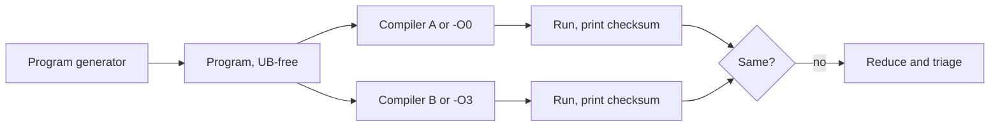

# Miscompilations versus Crashes

A compiler is trusted more than almost any other program. Developers read their source code, audit their source code, formally verify their source code, and then hand it to a compiler whose output almost nobody reads. If the compiler silently changes the meaning of the program, every review upstream is undermined. This book is about finding such bugs systematically in C, Rust, Solidity and Vyper compilers.

## Two kinds of compiler bug

| Kind | Symptom | How you notice | Typical severity |
|---|---|---|---|
| Crash bug | compiler segfaults, asserts, or reports an internal compiler error (ICE) | the build fails loudly | annoying; denial of service for build systems |
| Miscompilation (wrong-code) | compiler succeeds but the binary behaves differently from what the source specifies | only by comparing behaviour | can be severe, silent and long-lived |
| Rejects-valid / accepts-invalid | valid program rejected, or invalid program accepted | conformance tests | usually functional, occasionally security relevant |
| Performance bug | output correct but much slower or larger | benchmarks | rarely security relevant |

Crash bugs are easy to detect, which is why most compiler fuzzers find more of them. Miscompilations are rarer and much more valuable. They are also harder to find because you need an **oracle**: some independent way to know what the program should do.

## Where miscompilations come from

Optimising compilers transform programs through dozens of passes: inlining, constant propagation, loop transformations, vectorisation, instruction selection, register allocation. Each pass assumes some invariants and must preserve semantics. A miscompilation happens when a pass is unsound for some input, often a corner case involving:

- integer overflow and wrap-around rules, signed versus unsigned;
- aliasing between pointers or storage locations;
- volatile accesses and memory ordering;
- loops with unusual trip counts (zero, one, or near the type's maximum);
- interactions between two passes that are each correct alone.

In smart contract compilers, add storage layout, ABI encoding and decoding, and the separation between memory, storage and calldata. A bug in how a compiler lays out storage can affect every contract compiled with that version, as the 2023 Vyper incident showed (chapter 5).

## Oracles for wrong code

Without a specification executable on its own, compiler fuzzing relies on relative oracles:

- **Differential testing across compilers**: GCC versus Clang, or two Solidity pipelines. If outputs differ, at least one is wrong (or the program is undefined).
- **Differential testing across optimisation levels**: `-O0` versus `-O3`. Unoptimised code is usually more trustworthy.
- **Metamorphic testing**: transform the program in a way that must preserve output, such as Equivalence Modulo Inputs (chapter 3), and compare.
- **Reference interpreters**: Miri for Rust MIR, the CompCert reference interpreter for C, or an EVM execution of an independently produced contract.

## The undefined behaviour problem

In C and C++, if a program has undefined behaviour (UB), the compiler may do anything, and different outputs are not a bug. This is the main source of false positives in C compiler fuzzing. Generators such as Csmith and YARPGen are built specifically to produce UB-free programs, and reducers must preserve UB-freedom while shrinking. Rust's safe subset has no UB by design, which simplifies the oracle, but unsafe code and compiler-specific features bring it back. Solidity and Vyper define their semantics more fully (checked arithmetic, defined revert behaviour), so differential testing has fewer false positives there, but differences between compiler versions are sometimes intentional changes.

## Why this matters for security

- **Smart contracts** are immutable after deployment and hold assets. A miscompilation that disables a check, such as a reentrancy lock, can be directly exploitable.
- **Security checks in system code**, like bounds checks or pointer comparisons, can be optimised away by an unsound pass.
- **Verified code** depends on the compiler too. Proofs about source code (see **rust-formal-verification** and **lean4-security-proofs**) assume a correct compiler unless the toolchain is verified, as CompCert is for most of its pipeline.

## How this book is organised

Chapter 2 covers random program generators. Chapter 3 covers EMI and test-case reduction. Chapter 4 focuses on `rustc`. Chapter 5 covers Solidity and Vyper. Chapter 6 adds LLM-generated programs with strict validation and ends with a programme checklist.

All fuzzing here targets compilers you install locally. When you find a bug, report it through the project's issue tracker or, for security-relevant smart contract compiler bugs, through its security policy, since deployed contracts may be at risk.

## Worked example

*Execution status: not executed in this book's CI; verify locally. No output shown here was observed by the author.*

See an optimisation-level difference caused by undefined behaviour, to understand why UB must be excluded.

1. Write `ub.c` with a function `int f(int x) { return x + 1 > x; }` and a `main` that prints `f(2147483647)`.
2. Compile with `gcc -O0 ub.c -o a0` and `gcc -O2 ub.c -o a2`, and run both.
3. Many compilers print `0` at `-O0` (the addition wraps on typical hardware) and `1` at `-O2` (the optimiser assumes signed overflow cannot happen). Results vary by version.
4. Now compile with `-fsanitize=undefined` and run: UBSan reports signed integer overflow.
5. Conclude: this difference is not a compiler bug, and any fuzzing pipeline must filter such programs before reporting.

## Common pitfalls

- Reporting differences caused by undefined behaviour as miscompilations.
- Counting crash bugs and wrong-code bugs together, hiding the rare valuable ones.
- Comparing compiler versions and forgetting that some behaviour changes are documented and intentional.
- Trusting `-O0` blindly; unoptimised pipelines have bugs too.
- Fuzzing an old release when the bug is already fixed on the main branch.

## Exercises

1. Reproduce the worked example with GCC and Clang and record which versions and levels differ.
2. Write a UB-free version of the same function and confirm all levels agree and UBSan is silent.
3. Pick a compiler bug tracker (GCC Bugzilla, LLVM GitHub issues or the Solidity bug list) and classify ten recent bugs as crash, wrong-code or other.

## Further reading

- Yang, Chen, Eide, Regehr, "Finding and Understanding Bugs in C Compilers", PLDI 2011.
- Chen et al., "A Survey of Compiler Testing", ACM Computing Surveys, 2020.
- [Solidity known bugs list](https://docs.soliditylang.org/en/latest/bugs.html)
- **ai-fuzzing-field-guide** and **neurosymbolic-contract-verification**
