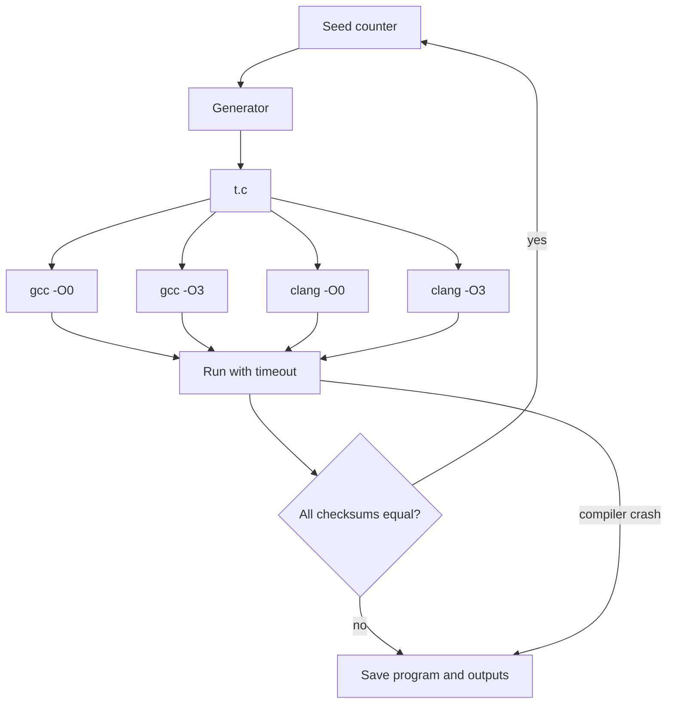

# Random Program Generation with Csmith and YARPGen

The classic way to fuzz an optimising compiler is to generate random programs that are guaranteed to be well defined, compile them in several ways, run them, and compare the output. Csmith made this approach famous; YARPGen extended it to stress specific optimisations. This chapter explains how both work and how to run them.

## Csmith

Csmith was developed at the University of Utah by Xuejun Yang, Yang Chen, Eric Eide and John Regehr, and described in "Finding and Understanding Bugs in C Compilers" (PLDI 2011). The paper reported hundreds of previously unknown bugs in GCC and LLVM, and notably found no wrong-code bugs in the formally verified parts of CompCert.

Key design ideas:

- **Expressiveness.** Generated programs use structs, unions, pointers, arrays, global and local variables, loops, and function calls, so they exercise many optimisations.
- **UB avoidance.** Arithmetic goes through safe wrapper macros (`safe_add_func_int32_t_s_s` and similar) that avoid overflow and division by zero. Static analyses during generation avoid null dereferences, out-of-bounds pointers, and use of uninitialised or dangling pointers.
- **Checksum output.** At the end, `main` hashes the values of all global variables and prints the checksum. Two compilations of the same program must print the same checksum.

```bash
csmith --seed 12345 > t.c
gcc   -O0 -w -I/usr/include/csmith t.c -o t_gcc_O0
clang -O3 -w -I/usr/include/csmith t.c -o t_clang_O3
./t_gcc_O0; ./t_clang_O3   # both print "checksum = ..."
```

The include path depends on how Csmith was installed (`/usr/include/csmith`, `/usr/local/include/csmith` or the source tree's `runtime/` directory).

## YARPGen

YARPGen (Yet Another Random Program Generator) was presented by Vsevolod Livinskii, Dmitry Babokin and John Regehr in "Random Testing for C and C++ Compilers with YARPGen" (OOPSLA 2020). Its authors observed that Csmith-style programs had become less effective because compilers had fixed the bugs those programs could reach. YARPGen introduced:

- **Generation policies** that bias programs towards patterns particular optimisations look for, such as specific arithmetic idioms and loop shapes, so passes actually fire.
- **UB avoidance by construction** using a lightweight value analysis during generation, rather than safe-math wrappers that can hide optimisation opportunities.
- **C++ support** in addition to C.

A later version focused on loop optimisations and data-parallel languages, described in "Fuzzing Loop Optimizations in Compilers for C++ and Data-Parallel Languages" (PLDI 2023), targeting vectorisation and loop transformations including for ISPC and SYCL.

## Comparing generators

| Property | Csmith | YARPGen |
|---|---|---|
| Languages | C | C, C++ (v2 adds data-parallel targets) |
| UB avoidance | safe-math wrappers plus generation-time analysis | generation-time value analysis |
| Optimisation targeting | general | policies for specific optimisations, loops in v2 |
| Output | checksum of globals | checksum / output comparison via a test driver |
| Main finds today | mostly on new targets or less-tested compilers | still productive on mainstream compilers' loop passes |

## Building a differential harness



Practical details:

- **Timeouts.** Random programs can loop for a long time. Csmith programs usually terminate but not always quickly; use a timeout and discard programs that time out at `-O0`.
- **Voting.** With four or more configurations, the minority result is the likely culprit, but check it rather than assume.
- **Crash triage.** Compiler crashes (ICEs) are bucketed by the assertion message or top frames.
- **Sanitisers on the generated program.** Even with UB-avoiding generators, run a sample with `-fsanitize=undefined,address` to catch generator bugs.

## Worked example

*Execution status: not executed in this book's CI; verify locally. No output shown here was observed by the author.*

Find out whether a local compiler pair disagrees on any of 2,000 Csmith programs.

1. Install Csmith from your distribution or build it from `https://github.com/csmith-project/csmith` with CMake.
2. Write a loop in shell or Python: for seeds 1 to 2000, run `csmith --seed $i > t$i.c`.
3. Compile each with `gcc -O0`, `gcc -O3`, `clang -O0` and `clang -O3`, each under a 30-second timeout, and run each binary under a 10-second timeout.
4. Record compile failures, run timeouts and checksum mismatches in a CSV.
5. For any mismatch, compile the program with `-fsanitize=undefined` at `-O0` and confirm UBSan is silent.
6. Bisect the configurations: try `-O1`, `-O2` and individual flags (such as `-fno-tree-vectorize` for GCC) to narrow which optimisation is involved.
7. Reduce with C-Reduce or cvise (chapter 3) before reporting.

On a current, mainstream compiler pair you may find nothing in 2,000 programs. That is a useful result too: it tells you that this configuration space is well covered and that you should try newer optimisation flags, other targets (for example a less common architecture under QEMU) or YARPGen.

## Common pitfalls

- Forgetting `-w` and drowning in warnings, or worse, ignoring warnings that point to generator-introduced UB.
- Not using timeouts, so one infinite loop stalls the whole campaign.
- Using a system compiler from an old distribution and rediscovering long-fixed bugs; build from the main branch.
- Comparing only one configuration pair; more configurations give more signal per program.
- Reporting unreduced 2,000-line programs to compiler developers.

## Exercises

1. Run the worked example for 2,000 seeds and report the number of crashes, timeouts and mismatches.
2. Repeat with an unusual target such as `-march=native -O3 -ffast-math` and explain why `-ffast-math` must be excluded from wrong-code oracles.
3. Build YARPGen from its repository, generate 200 tests, and compare the number of distinct LLVM passes that changed the IR (`-mllvm -print-changed` or similar) against 200 Csmith tests.

## Further reading

- [Csmith repository](https://github.com/csmith-project/csmith)
- [YARPGen repository](https://github.com/intel/yarpgen)
- Yang, Chen, Eide, Regehr, "Finding and Understanding Bugs in C Compilers", PLDI 2011.
- Livinskii, Babokin, Regehr, "Random Testing for C and C++ Compilers with YARPGen", OOPSLA 2020.
- Livinskii et al., "Fuzzing Loop Optimizations in Compilers for C++ and Data-Parallel Languages", PLDI 2023.
