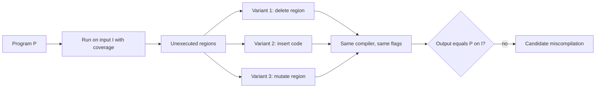

# Equivalence Modulo Inputs and Test-Case Reduction

Differential testing across compilers needs at least two compilers that accept the same language. Equivalence Modulo Inputs (EMI) removes that requirement: it derives many variants of one program that must behave identically on a given input, and compares a single compiler against itself. This chapter also covers test-case reduction, which turns a large failing program into a report a compiler developer can act on.

## The EMI idea

EMI was introduced by Vu Le, Mehrdad Afshari and Zhendong Su in "Compiler Validation via Equivalence Modulo Inputs" (PLDI 2014). The insight is simple:

1. Run a program P on input I and record which statements execute (profile with coverage tools such as `gcov`).
2. Statements that never executed on I are dead *for that input*. Deleting or changing them cannot change the output on I.
3. Generate variants P1, P2, ... by pruning, inserting or mutating unexecuted code.
4. Compile each variant with the same compiler and flags and run on I. All must produce the same output as P.

If a variant differs, the compiler mishandled it. Because the dead code changes, the optimiser sees different control flow, inlining decisions and register pressure, which exposes bugs that the original program never triggered.



## The EMI family

| Tool / paper | Variant strategy |
|---|---|
| Orion (Le, Afshari, Su, PLDI 2014) | randomly prune unexecuted statements |
| Athena (Le, Sun, Su, OOPSLA 2015) | delete and insert code in dead regions, guided by Markov chain Monte Carlo |
| Hermes (Sun, Le, Su, OOPSLA 2016) | mutate live code too, while preserving output with synthesised guards |

The authors reported large numbers of bugs in GCC and LLVM across these tools. EMI also generalises beyond C: the idea of variants that must behave equivalently on a fixed input works for any language with a profiler. It has been applied to OpenCL compilers and graphics shader compilers among others, and the same metamorphic thinking underlies many smart contract compiler tests.

## Pitfalls specific to EMI

- **UB still matters.** Deleting dead code can make a program UB-free on I into one that is not, for example by removing an initialisation that executes in a different path. Check variants with sanitizers.
- **Coverage must be precise.** If the profiler marks a statement unexecuted when it actually ran (e.g. due to macro expansion or optimised coverage builds), variants are not equivalent. Profile at `-O0`.
- **Timeouts.** Inserting code can create infinite loops.

## Test-case reduction

A miscompilation found by a generator often sits in a program of thousands of lines. Developers need tens. Reduction tools apply transformations repeatedly while an **interestingness test** keeps returning success.

| Tool | Notes |
|---|---|
| C-Reduce | Regehr et al., "Test-Case Reduction for C Compiler Bugs", PLDI 2012; C-aware transformations plus line-based passes |
| cvise | Python reimplementation of C-Reduce, actively maintained, packaged by many distributions |
| creduce/cvise on other languages | line and token passes work on Rust, Solidity, JS with lower efficiency |
| `treereduce`, Perses-style tools | grammar-aware reduction for any language with a grammar |

The interestingness test is a shell script that exits 0 only if the reduced program still shows the bug. For wrong-code bugs it must also guard against UB, or the reducer will happily produce a tiny program whose "miscompilation" is just undefined behaviour.

```bash
#!/bin/bash
# interesting.sh: exit 0 if -O0 and -O3 disagree and the program is UB-free
gcc -O0 -w t.c -o o0 && gcc -O3 -w t.c -o o3 || exit 1
clang -O0 -fsanitize=undefined,address -fno-sanitize-recover=all -w t.c -o san || exit 1
timeout 5 ./san >/dev/null 2>&1 || exit 1
a=$(timeout 5 ./o0) || exit 1
b=$(timeout 5 ./o3) || exit 1
[ "$a" != "$b" ]
```

Sanitizers cannot catch every kind of UB (for example some aliasing violations and unsequenced modifications), so experienced reporters also check reduced programs with additional tools such as the CompCert interpreter or Frama-C, and read the final program carefully by hand.

## Bisection

Once reduced, bisect the compiler's history to find the commit that introduced the bug. GCC and LLVM both build quickly enough for automated `git bisect run` with the interestingness script. A report that names a commit and a 20-line program is usually fixed quickly.

## Worked example

*Execution status: not executed in this book's CI; verify locally. No output shown here was observed by the author.*

Reduce a mismatching Csmith program from chapter 2 and prepare it for reporting.

1. Copy the program to `t.c` and save the interestingness script above as `interesting.sh`, editing compilers and flags to match your mismatch.
2. Run `./interesting.sh; echo $?` and confirm it prints `0`.
3. Run `cvise interesting.sh t.c` (or `creduce interesting.sh t.c`). It rewrites `t.c` in place, keeping a backup.
4. When reduction finishes, read the program. Add `printf` statements if needed to show the differing value.
5. Re-run with a fresh build of the compiler's main branch to confirm the bug still exists.
6. Bisect: `git bisect start <bad> <good>` in the compiler checkout, then `git bisect run` with a script that builds the compiler and runs `interesting.sh`.
7. File the report with the reduced program, flags, expected and actual output, and the first bad commit.

## Common pitfalls

- An interestingness test that does not check UB, producing a reduced program that is not a real bug.
- Profiling coverage for EMI with an optimised build, marking live code as dead.
- Letting reduction run against a different compiler build than the one that showed the bug.
- Over-reducing until the bug changes into a different crash or mismatch.
- Forgetting to include exact compiler version and flags in the report.

## Exercises

1. Implement a minimal Orion-style EMI tool: use `gcov` to find unexecuted lines in a Csmith program and generate 50 variants by deleting random subsets.
2. Write an interestingness script for an ICE (compiler crash) that matches a specific assertion message, and reduce a crashing input with cvise.
3. Use `git bisect run` on a small compiler (for example TinyCC, or a toy compiler you wrote) to find an introduced regression.

## Further reading

- Le, Afshari, Su, "Compiler Validation via Equivalence Modulo Inputs", PLDI 2014.
- Le, Sun, Su, "Finding Deep Compiler Bugs via Guided Stochastic Program Mutation", OOPSLA 2015.
- Regehr et al., "Test-Case Reduction for C Compiler Bugs", PLDI 2012.
- [cvise](https://github.com/marxin/cvise) and [C-Reduce](https://github.com/csmith-project/creduce)
