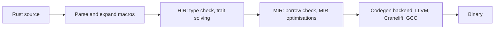

# Fuzzing the Rust Compiler

Rust's promise of memory safety rests on the compiler. The type checker and borrow checker must reject unsound programs, and the backend (usually LLVM) must compile accepted programs correctly. That gives three distinct targets: front-end crashes, soundness holes that accept programs they should reject, and miscompilations in MIR optimisations or code generation.

## Pipeline and targets

| Stage | Bug type | Oracle |
|---|---|---|
| Parser, macro expansion, type checker | internal compiler error (ICE) | rustc panics with "error: internal compiler error" |
| Trait solver, borrow checker | soundness hole: unsafe behaviour from safe code | Miri reports UB on a safe program; manual review |
| MIR optimisations | wrong code | compare against Miri or unoptimised build |
| LLVM / backend | wrong code, crash | compare debug vs release, or LLVM vs Cranelift backend |

The Rust project labels issues on GitHub: `I-ICE` for internal compiler errors, `I-unsound` for soundness holes and `I-miscompile` for wrong-code bugs. Browsing these labels is the fastest way to understand what kinds of bugs are found today.

## Tools

**icemaker** (by Matthias Krüger) runs rustc, rustdoc, clippy and other tools over large corpora of Rust files, including the compiler's own regression tests, with many flag combinations, and records ICEs. It also mutates files with tree-splicing. It has found a large number of ICEs reported to the Rust issue tracker.

**Rustlantis**, described by Qian Wang and Ralf Jung in "Rustlantis: Randomized Differential Testing of the Rust Compiler" (OOPSLA 2024), generates programs directly in MIR using rustc's custom MIR syntax, with UB avoided by construction. It runs them under Miri and compiled with various optimisation settings and backends, and compares outputs. Because the programs are UB-free and Miri is a reference interpreter, a mismatch is strong evidence of a miscompilation.

**RustSmith** (Sharma, Yu, Donaldson, ISSTA 2023 tool track) is a Csmith-style generator for surface Rust that produces programs which pass the borrow checker, for differential testing across optimisation levels.

**cargo-fuzz / libFuzzer** can fuzz individual compiler components that are libraries, such as parsers in the wider ecosystem, but whole-compiler fuzzing usually uses the generator approach.

## Miri as an oracle

Miri is an interpreter for MIR that detects many forms of undefined behaviour: out-of-bounds access, use-after-free, invalid values, and violations of aliasing models (Stacked Borrows or Tree Borrows). For compiler testing it serves two roles:

- **Reference semantics**: a UB-free program's output under Miri is the expected output.
- **UB filter**: if Miri reports UB, a mismatch between optimisation levels is not a compiler bug (for programs using `unsafe`).

Miri is slow, so generated programs should be short-running.

## Soundness holes

A soundness hole is a program written entirely in safe Rust that causes undefined behaviour, usually through an edge case in trait resolution, lifetimes or variance. These are not found by output comparison; they are found by running suspicious safe programs under Miri and by expert review. Several long-standing holes are tracked publicly on GitHub with the `I-unsound` label. If a fuzzer produces a safe program that Miri flags, that is a candidate soundness report.

## Optimisation and backend differences

Useful configuration pairs for differential testing:

| Configuration A | Configuration B |
|---|---|
| `-C opt-level=0` | `-C opt-level=3` |
| `-Z mir-opt-level=0` | `-Z mir-opt-level=4` (nightly) |
| LLVM backend | Cranelift backend (`rustc_codegen_cranelift`, nightly) |
| debug assertions on | release without overflow checks (different semantics; only compare programs that do not overflow) |

Remember that release builds disable integer overflow checks by default. A program that overflows panics in debug and wraps in release; that is documented behaviour, not a bug.

## Worked example

*Execution status: not executed in this book's CI; verify locally. No output shown here was observed by the author.*

Run a short ICE hunt with icemaker and triage one result. Follow the current README if the interface changed.

1. Install a nightly toolchain with `rustup toolchain install nightly` and clone `https://github.com/matthiaskrgr/icemaker`.
2. Clone the `rust-lang/rust` repository; its `tests/ui` directory provides a large corpus of tricky files.
3. Build icemaker with `cargo build --release` and run it from the directory containing the test files, as its README describes, restricting it to rustc to keep the run short.
4. Inspect the output file listing ICEs. Pick one and rerun the reported `rustc` command by hand to confirm it panics.
5. Search the Rust issue tracker for the panic message to check for duplicates.
6. Reduce the file using `treereduce-rust` or cvise with an interestingness script that greps for the panic message.
7. If new, file an issue with the reduced code, the exact `rustc --version --verbose` output and flags.

ICEs are normal bugs, reported publicly. If you believe you have a soundness hole or miscompilation with security impact, read the Rust security policy first; the project asks for some issues to be reported privately.

## Common pitfalls

- Reporting overflow wrap-around in release mode as a miscompilation.
- Using `unsafe` in generated programs without running Miri, then reporting UB as compiler bugs.
- Fuzzing a stale nightly; ICEs are often fixed within days.
- Filing duplicates of well-known ICEs instead of searching the panic message.
- Reporting rustdoc or clippy ICEs as rustc bugs; label the right tool.

## Exercises

1. Write three small programs that behave differently with and without `-C overflow-checks`, and explain why none is a compiler bug.
2. Install Miri (`rustup +nightly component add miri`) and run a program with a deliberate out-of-bounds raw pointer read; record the report.
3. Build Rustlantis from its repository, generate 100 programs, and run its differential checker across `opt-level` 0 and 3.

## Further reading

- Qian Wang, Ralf Jung, "Rustlantis: Randomized Differential Testing of the Rust Compiler", OOPSLA 2024.
- Sharma, Yu, Donaldson, "RustSmith: Random Differential Compiler Testing for Rust", ISSTA 2023.
- [icemaker](https://github.com/matthiaskrgr/icemaker) and [Miri](https://github.com/rust-lang/miri)
- [Rust security policy](https://www.rust-lang.org/policies/security)
- **rust-formal-verification** for proving properties of Rust source.
