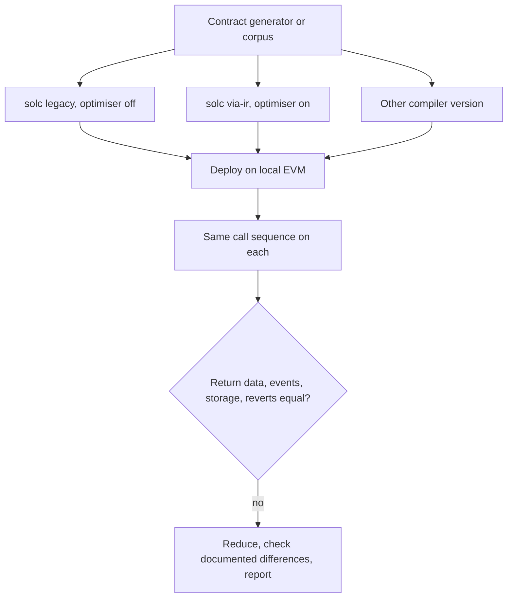

# Smart Contract Compilers: solc and Vyper

Smart contract compilers sit in an unusual risk position. Their output is deployed once, cannot normally be changed, and controls assets directly. A miscompilation can be exploitable by anyone who notices it, and every contract built with the affected version is a potential victim. This chapter covers how the Solidity compiler (`solc`) and the Vyper compiler work, what has gone wrong, and how to fuzz them differentially on your own machine.

## Pipelines

| Compiler | Pipelines | Optimisers |
|---|---|---|
| solc | legacy codegen (Solidity to EVM assembly) and IR-based codegen (`--via-ir`: Solidity to Yul to EVM) | legacy opcode-based optimiser; Yul optimiser with many steps |
| Vyper | Vyper to an internal IR to EVM; newer versions add a new IR and backend (check current docs) | optimisation modes selectable by flag in recent versions |

Two independent pipelines in solc give a natural differential oracle: the same contract compiled through legacy and via-IR should behave the same, apart from documented differences (the Solidity documentation lists semantic differences such as evaluation order in some expressions and the order of state variable initialisation). Optimiser on versus off is another natural pair.

## Known bug history

The Solidity team publishes a machine-readable list of known compiler bugs, `bugs.json`, with the affected version range, a description and conditions under which each bug triggers, and `bugs_by_version.json` mapping versions to bugs. Many entries are optimiser bugs affecting particular code shapes, and several concern storage writes, inline assembly or ABI encoding. Reading this list is the best introduction to what smart contract miscompilations look like in practice. Etherscan and Sourcify show compiler versions for verified contracts, which lets auditors check exposure.

## Case study: the 2023 Vyper reentrancy lock miscompilation

On 30 July 2023 several Curve Finance pools written in Vyper were drained. According to the Vyper team's post-mortem and the analyses that followed, contracts compiled with Vyper versions 0.2.15, 0.2.16 and 0.3.0 had a broken `@nonreentrant` guard: functions that were meant to share one reentrancy lock were each allocated a different storage slot for it, so a call into one guarded function did not block reentry into another. Pools that combined such contracts with raw ETH transfers (which hand control to the receiver) were exploitable through cross-function reentrancy. Reported losses across the affected protocols were in the tens of millions of US dollars (around US$70M in contemporaneous reports), and part was later returned.

Lessons for compiler fuzzing:

- **The bug was a semantic property across functions**, not a crash and not a single-function wrong value. Output comparison on single calls would not see it. An oracle needed to model "these two functions share a lock".
- **The source looked correct.** Source-level audits of the pools could not see the fault, because the fault was in the compiler.
- **A fix had already landed in a later version** without being recognised as security relevant, according to the post-mortem. Version-aware exposure analysis matters as much as finding the bug.

## Differential fuzzing setups

What to compare after each call:

- return data and revert status (and revert data, with care: messages can legitimately differ);
- emitted events;
- storage slots touched (dump with a local node's debug APIs or Foundry's storage cheatcodes);
- balances.

Gas usage always differs, so exclude it, and set a high gas limit so that cheaper and more expensive builds both complete.

Sources of programs:

- **Existing test suites**: solc's semantic tests (`test/libsolidity/semanticTests`) and Vyper's test suite are rich corpora with expected outputs.
- **Generators**: the Solidity project runs protobuf-based Solidity and Yul program generators under OSS-Fuzz, including differential checks of the Yul optimiser using its Yul interpreter.
- **LLM-generated contracts**: useful for variety, validated by compilation and execution (chapter 6).

For multi-function properties like reentrancy locks, write **property harnesses** rather than plain output comparisons: for every pair of functions declared with the same lock key, test that calling one from within the other reverts. This turns a language guarantee into an executable check that can run against every compiler version.

## Worked example

*Execution status: not executed in this book's CI; verify locally. No output shown here was observed by the author.*

Check whether two solc pipelines agree on a small contract, using Foundry on your own machine.

1. Install Foundry (`foundryup`) and create a project with `forge init cmpdiff`.
2. Write a contract with a few functions exercising arithmetic, `bytes` handling and a storage struct.
3. Add two profiles to `foundry.toml`: `[profile.legacy]` with `optimizer = false`, and `[profile.viair]` with `via_ir = true` and `optimizer = true`.
4. Write a Foundry test that calls each function with fuzzed inputs and writes results (return values and a hash of relevant storage) with `console.log`.
5. Run `FOUNDRY_PROFILE=legacy forge test -vv` and `FOUNDRY_PROFILE=viair forge test -vv` with the same fuzz seed (`--fuzz-seed`), and diff the logs.
6. For any difference, consult the Solidity documentation's list of via-IR semantic changes before treating it as a bug.
7. As a Vyper analogue, install two Vyper versions with `pip`, compile a contract with two functions sharing `@nonreentrant` key, and use Titanoboa to verify that reentry from one into the other reverts on each version.

## Common pitfalls

- Comparing gas or revert strings and reporting expected differences.
- Ignoring documented semantic differences between legacy and via-IR codegen.
- Testing only single calls when the guarantee spans functions or transactions.
- Reporting a live-impact compiler bug publicly before the compiler team and affected projects can respond; use the project's security contact.
- Testing on a public network instead of a local EVM.

## Exercises

1. Download `bugs.json` from the Solidity repository and write a script that, given a compiler version, lists the known bugs affecting it.
2. Implement the reentrancy-lock property harness for Vyper using Titanoboa and run it against at least three compiler versions you install locally.
3. Take ten semantic tests from the solc repository, run them under both pipelines with optimiser on and off, and record any mismatch.

## Further reading

- [Solidity known bugs list](https://docs.soliditylang.org/en/latest/bugs.html)
- [Solidity IR-based codegen changes](https://docs.soliditylang.org/en/latest/ir-breaking-changes.html)
- Vyper team, technical post-mortem of the July 2023 nonreentrancy lock vulnerability (search the Vyper project's blog or HackMD).
- [Vyper documentation](https://docs.vyperlang.org/) and [Titanoboa](https://github.com/vyperlang/titanoboa)
- **neurosymbolic-contract-verification** and **llm-smart-contract-vuln-research**
