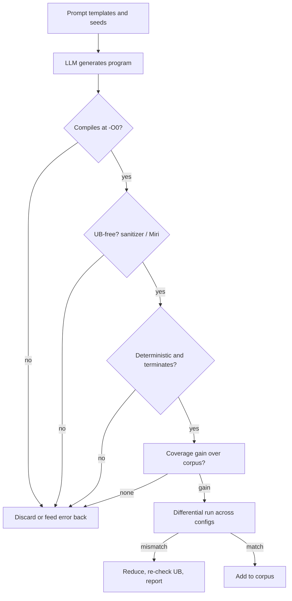

# LLM-Generated Programs and a Compiler Fuzzing Programme

Hand-written generators such as Csmith encode one person's idea of what programs look like. Large language models have read a great deal of real code and can produce programs that use idioms, library calls and language features a generator author never modelled. The catch is that LLM output may be invalid, may contain undefined behaviour and cannot itself tell you whether a compiler is wrong. This chapter shows how to use LLMs inside a pipeline where compilers, sanitisers and differential oracles do the judging, then sets out a programme checklist and research directions.

## What LLMs add

| Strength | Weakness | Check that compensates |
|---|---|---|
| Realistic idioms and API use | syntax or type errors | compile with the target compiler |
| Coverage of new language features | invented features that do not exist | compile, and confirm the feature appears in the AST |
| Can be steered by prompts ("use loops with unusual trip counts") | undefined behaviour in C/C++, unsafe Rust | UBSan/ASan, Miri, CompCert interpreter |
| Can mutate existing tests | outputs repeat themselves | deduplicate by hash and measure coverage gain |

Research supports the approach when checking is built in. Fuzz4All (Xia et al., ICSE 2024) used LLMs to generate and mutate inputs for compilers and other language processors (including GCC, Clang, Go, javac and SMT solvers), with the target tool deciding validity and crashes, and reported previously unknown bugs. WhiteFox (Yang et al., OOPSLA 2024) used LLMs to read optimisation source code and produce programs designed to trigger specific optimisations in deep-learning compilers, again with the compilers and output comparisons as oracles.

## A validated pipeline

Stage by stage:

1. **Compile.** The compiler is the syntax and type oracle. Feeding errors back for one retry is cheap and often fixes small mistakes.
2. **UB filter.** For C/C++, compile with `-fsanitize=undefined,address` and run. For Rust with `unsafe`, run under Miri. For Solidity and Vyper, UB is rare, but check for reliance on unspecified behaviour such as evaluation order.
3. **Determinism.** Run twice. Remove programs that read time, addresses or uninitialised memory.
4. **Coverage gain.** Build the compiler with coverage (`--coverage` for GCC; LLVM's source-based coverage) and keep programs that cover new lines or branches in optimisation passes. This is the real measure of value.
5. **Differential execution** across optimisation levels, compilers or pipelines.
6. **Re-check after reduction.** Reducers can introduce UB; re-run the filter on the final program.

The model never decides that a bug exists. It only proposes programs. Every claim in a report is backed by a compiler output, a sanitiser result or a differential mismatch that anyone can reproduce.

## Prompting for compiler stress

Prompts that worked well in practice target optimisation preconditions rather than "write a random program":

- "Write a C function with a loop whose trip count depends on a `uint8_t` that can wrap, and print every intermediate value."
- "Write a Solidity contract that packs several small integers into one storage slot and updates them through different functions."
- "Write Rust code with nested iterators, closures capturing by reference, and integer arithmetic at type boundaries, without `unsafe`."

Combine with mutation: give the model an existing regression test from the compiler's test suite and ask it to vary types, constants and control flow while keeping the structure.

## Programme checklist

- [ ] Compilers built from the main branch, rebuilt regularly, with assertions enabled.
- [ ] At least two oracles per target (cross-level and cross-compiler or cross-pipeline).
- [ ] UB filtering at generation, before reporting and after reduction.
- [ ] Automated reduction and bisection.
- [ ] Deduplication by assertion message for crashes and by first bad commit for wrong code.
- [ ] Coverage tracking to decide which generator, prompts or seeds are productive.
- [ ] For smart contract compilers: exposure analysis by compiler version and private disclosure to the compiler team for security-relevant bugs.
- [ ] LLM output treated as untrusted input; every report reproducible without the model.

## Research directions

- **Semantic oracles beyond outputs.** The Vyper lock bug shows that some guarantees are cross-function properties. Generating property harnesses from language specifications is open work.
- **Translation validation.** Tools such as Alive2 check LLVM optimisations for refinement on individual functions; extending such checking to other compilers and to EVM backends would catch bugs without needing a triggering input.
- **Targeted generation.** Reading an optimisation pass and generating programs that reach it, as WhiteFox did for deep-learning compilers, could apply to MIR and Yul optimisers.
- **Verified compilers for contracts.** CompCert showed what is possible for C; verified or translation-validated contract compilers remain a research area (see **neurosymbolic-contract-verification**).

## Worked example

*Execution status: not executed in this book's CI; verify locally. No output shown here was observed by the author.*

Run a small LLM-assisted C campaign with full validation.

1. Write five prompt templates like those above and ask a model for 100 programs each, saved as separate files.
2. Compile each with `clang -O0 -w`; record the pass rate.
3. For passing programs, compile with `-fsanitize=undefined,address -fno-sanitize-recover=all` and run with a five-second timeout; discard any that report UB or time out.
4. Run survivors twice and discard any whose outputs differ.
5. Build GCC with `--coverage` (or use LLVM source-based coverage for Clang) and measure the line coverage gained by survivors versus 500 Csmith programs.
6. Run the differential harness from chapter 2 on survivors.
7. Record counts at each stage in a table. That funnel is the honest measure of what the model contributed.

## Common pitfalls

- Reporting a model's explanation of a "bug" without a reproducible mismatch.
- Skipping the UB filter because the program "looks fine".
- Measuring the number of generated programs rather than coverage gained.
- Leaking unreleased code or embargoed bug details into a third-party model API.
- Letting the model rewrite the reduced test case, which may change its meaning.

## Exercises

1. Implement the worked example funnel and publish the stage-by-stage counts for your run.
2. Write a prompt that targets one specific LLVM pass (for example loop unrolling) and use `-mllvm -debug-pass-manager` or optimisation remarks (`-Rpass=loop-unroll`) to measure how often generated programs actually trigger it.
3. Draft a property harness for one Solidity language guarantee (for example, checked arithmetic reverts on overflow) and run it across three compiler versions.

## Further reading

- Xia et al., "Fuzz4All: Universal Fuzzing with Large Language Models", ICSE 2024.
- Yang et al., "WhiteFox: White-box Compiler Fuzzing Empowered by Large Language Models", OOPSLA 2024.
- Lopes et al., "Alive2: Bounded Translation Validation for LLVM", PLDI 2021.
- [CompCert](https://compcert.org/)
- **ai-fuzzing-field-guide** and **synthetic-vulnerability-datasets**
